# Predicting Land Prices in the Colombo District

**Module:** IT5514 Applied Machine Learning &nbsp;&nbsp;|&nbsp;&nbsp; **Assignment 02** &nbsp;&nbsp;|&nbsp;&nbsp; **Individual Assignment**

**Name:** _______________________ &nbsp;&nbsp;&nbsp;&nbsp; **Index Number:** _______________________

---

## 1. Introduction

Land is the largest purchase most Sri Lankan families ever make, yet there is no public, plot-level price
index for the Colombo district. Buyers and sellers mostly judge prices from a handful of advertisements in
the same area, and asking prices for similar land can differ several times over. The aim of this assignment
was to build a model that estimates a fair **asking price per perch** for a plot of land in the Colombo
district, from its area, size, land type and the facilities around it.

The work follows the assignment guideline given in class:

1. A local (Sri Lankan) dataset was used.
2. The data was analysed and preprocessed.
3. Random Forest and XGBoost were applied, with hyperparameters designed and tuned rather than left at their
   defaults, and other models suited to the problem were added (LightGBM, CatBoost and a stacked ensemble).
4. Performance was evaluated and compared, and the results were interpreted, including model explainability
   with SHAP and LIME.
5. Inference was demonstrated on a listing kept aside from all training and testing, through a small
   front-end application that loads the saved (pickled) model.
6. The project was published to a GitHub repository with an automated MLOps pipeline (retraining, quality gate,
   tests and continuous integration), and the application was deployed online.

The main task is **regression** (predicting the price). As an extension, the same problem was also framed
as **classification** into Low, Medium and High price bands.

All the work was done in Python with Pandas, scikit-learn, XGBoost, LightGBM and CatBoost. The accompanying
files are:

| File | Contents |
|---|---|
| `01_data_preparation.ipynb` | Cleaning and preprocessing (Section 3) |
| `02_modelling.ipynb` | Models, tuning, comparison, interpretation, classification, inference (Sections 4-7) |
| `03_unseen_areas.ipynb` | Check of how well the models work for areas they have never seen (Section 6.3) |
| `04_explainability.ipynb` | SHAP and LIME explanations of the final model (Section 6.4) |
| `app.py`, `catboost_wrapper.py` | Front-end application (Section 7) |
| `land_price_model.pkl` | Saved final models |

---

## 2. Dataset

**Source.** *Land prices of Colombo district*, published on Kaggle by user ruchiraayeshmantha
(https://www.kaggle.com/datasets/ruchiraayeshmantha/land-prices-of-colombo-district). The dataset
contains land sale advertisements from the Colombo district, posted between **31 July and 21 September 2021**.
Each advertisement was enriched with location information: the distance to Colombo Fort, and the distance to
and number of nearby schools, universities, hospitals, banks, finance companies, supermarkets, fuel stations,
railway stations and expressway entrances.

The file has **4,494 rows and 35 columns** with **no missing values**:

| Group | Columns |
|---|---|
| Listing | `Address` (area name, 160 areas), `Land_size(Perches)`, `Land_type`, `Posted_Date_new` |
| Price | `Mentioned Price(Rs)`, `Price_Scale`, `Price per Perch` |
| Location | 27 distance and count features (e.g. `Distance from fort`, `min_dist_nearest_railway`, `count_banks_within_2km`) |
| Other | `Address_ID` (row identifier) |

The busiest areas are Ranala (350 listings), Makandana (270), Kaduwela (250), Kesbewa (206) and
Piliyandala (204). These are suburban areas where large blocks of land are divided and sold plot by plot.

---

## 3. Data Preparation

### 3.1 Choice of target

Two columns describe the price: `Mentioned Price(Rs)` (the number written in the advertisement) and
`Price per Perch`. **Price per perch** was chosen as the target, because it makes plots of different sizes
comparable. A 6-perch plot in Nugegoda and a 40-perch plot in Kaduwela can't be compared on total price, but
they can be compared per perch, and this is also how land is normally advertised and discussed in
Sri Lanka.

`Mentioned Price(Rs)` was then **removed from the features**. For most rows it is either identical to the
target or equal to the target multiplied by the land size, so leaving it in would hand the model the answer
(data leakage). `Address_ID` was also removed, since it is just a row number.

### 3.2 Price scale

Advertisers quote prices in different ways, recorded in `Price_Scale`: per perch (3,568 rows), as a total
price (923 rows), or per acre (3 rows). Checking `Price per Perch` against the mentioned price for each scale
showed that:

* **per perch:** `Price per Perch` equals the mentioned price, which is correct
* **total price:** `Price per Perch` equals the mentioned price ÷ land size, so these were already converted
  correctly
* **per acre:** `Price per Perch` still held the **per-acre** price, which is wrong

The three per-acre rows were corrected by dividing by 160 (1 acre = 160 perches). After that, `Price_Scale`
only describes how the advertisement was written, not the land, so it was dropped.

### 3.3 Duplicates

After removing the ID and the mentioned price, **198 rows were exact duplicates** and were removed (4,296
rows remained). This is more than the 177 duplicates in the raw file. The difference is listings that were
posted twice, once as a per-perch price and once as a total price: they become identical once the price is
expressed per perch. Duplicates were removed **before** splitting the data, so the same listing could not
end up in both the training and the test set.

### 3.4 Skewed target and outliers

The price per perch ranges from about Rs 4,600 to Rs 85 million, with a median of about Rs 900,000.
The distribution is extremely right-skewed (skewness 7.19), as Figure 1 shows.

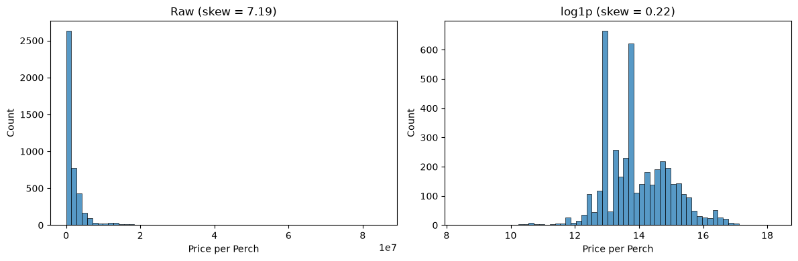

Applying the IQR rule from the module's feature-engineering lab directly to this target would flag 297
listings as outliers. Most of them are genuine, expensive land close to the city centre, so removing them
would remove exactly the information the model needs about central Colombo. Instead:

1. The target was **log-transformed** with `log1p`, which reduces the skewness to 0.22.
2. The IQR rule was applied on the **log scale**, which flags only **21 listings**. These are extreme values
   such as a few thousand rupees per perch (almost certainly typos or a misread price scale), and they were
   removed. **4,275 rows** remained.
3. All models predict the log price. Predictions are converted back to rupees with `expm1`.

Outliers in the features (distances and counts) were left alone, because tree-based models split on
thresholds and are not distorted by extreme feature values the way linear models are.

The two tall peaks in the log histogram come from popular round asking prices (for example Rs 400,000,
430,000 and 450,000 per perch). They are mostly in suburban areas such as Kaduwela, Homagama and Bomiriya,
where developers sell many plots from the same block at the same price.

### 3.5 Land type

`Land_type` combines several types in one value, for example "Commercial, Residential, Other", giving
14 different combinations, some with only 1-3 listings. Since a plot can legitimately be several types at
once, it was split into four yes/no columns: `is_Residential`, `is_Commercial`, `is_Agricultural` and
`is_Other`. This way a "Commercial, Residential" plot shares information with all other commercial plots and
all other residential plots, instead of being a rare category of its own.

### 3.6 Posting date and area

* **Posting date** was dropped. All listings were posted within about eight weeks, which is too short for
  land prices to change meaningfully, so the date would mostly add noise.
* **Area (`Address`)** has 160 values. One-hot encoding would add 160 sparse columns, so it was **target
  encoded** instead: each area is replaced by its average log price, using scikit-learn's `TargetEncoder`.
  The encoder uses internal cross-fitting, so a listing's own price is never used to encode it. CatBoost
  handles the area natively (Section 4.3).
* **Scaling** was applied only for the linear baseline (Ridge regression), whose penalty treats all
  coefficients equally and therefore needs features on comparable scales. Tree-based models don't need
  scaling, because a split on "distance < 5 km" works the same whatever the units.

### 3.7 Location features are recorded per area, not per plot

While interpreting the results, an important property of the data came to light: **all 27 location
features have exactly one value per area.** The distances and counts were calculated from the area name,
not from each plot's position, so every listing in, say, Kaduwela has the same distance to Fort, the same
number of nearby banks, and so on. The whole dataset contains only 160 distinct location "points", one for
each area.

So, within an area, the only things that differ between listings are the land size, the land type and the
price itself. This has three consequences, discussed in Sections 6.1, 6.3 and 7: the feature importances
must be read carefully, a separate test on unseen areas is needed, and the application should not let users
edit the location values.

### 3.8 Exploratory analysis of the cleaned data

Two questions were explored before modelling: how much price depends on the area, and which features move
with price and with each other.

**Price by area.** The 160 areas are very unevenly represented. The median area has only 8 listings, and
88 areas have fewer than 10. Among the 58 areas with at least 15 listings, the median price per perch ranges
from about **Rs 215,000 in Kosgama to Rs 18 million in Kurunduwatta, an 84-fold difference** (Figure 2). The
most expensive areas are all in central Colombo (Kurunduwatta, Kollupitiya, Bambalapitiya, Havelock Town,
Wellawatta). The cheapest are on the outer eastern and south-eastern edge of the district (Kosgama, Bope,
Padukka, Meegoda, Dampe).

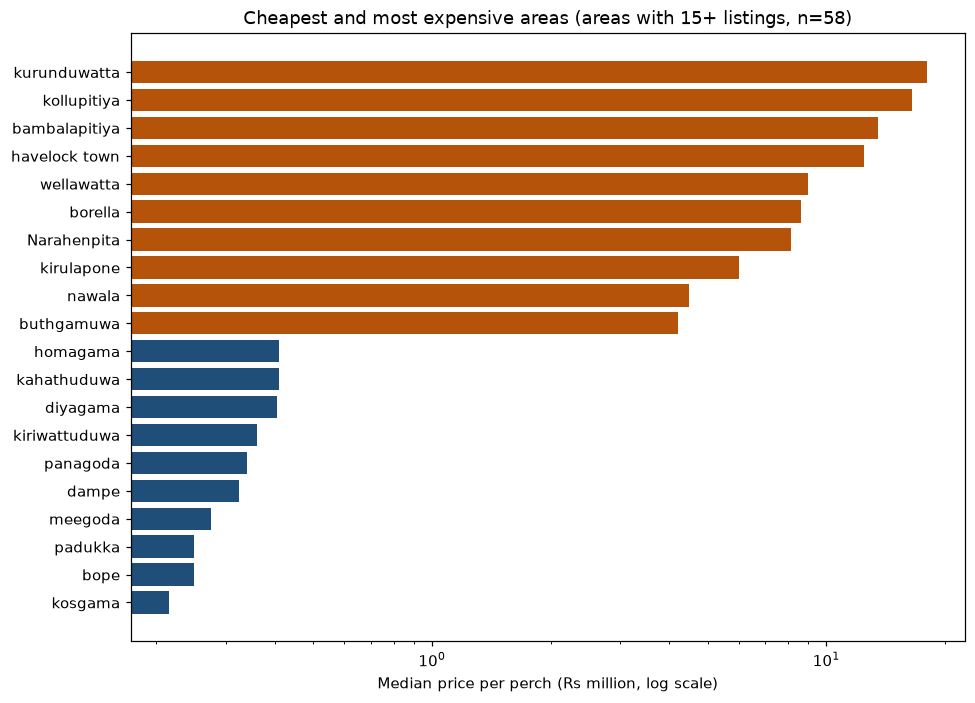

Two modelling decisions follow from this. First, the area is likely to be the single most informative piece
of information. Second, with so many rare areas, one-hot encoding would create many columns that each describe
only a handful of listings. Cross-fitted target encoding and CatBoost's native handling cope much better with
rare categories (Section 3.6).

**Correlations.** Spearman correlation was used instead of Pearson, because prices are heavily skewed and the
relationships only need to be consistently increasing or decreasing, not straight lines (Figure 3, left).

* **Distance from Fort** has the strongest relationship with price (ρ = −0.81), followed by **distance to the
  nearest grade-A government school** (−0.78).
* The **number of supermarkets** (+0.76) and **banks** (+0.75) within 2 km are the strongest positive
  relationships. They act as measures of how built-up and commercial an area is.
* **Land size** is positively related to price per perch (ρ = +0.40), which is unexpected; Section 6.1
  discusses why.
* The **land type** columns have weak relationships with price on their own (|ρ| < 0.15).

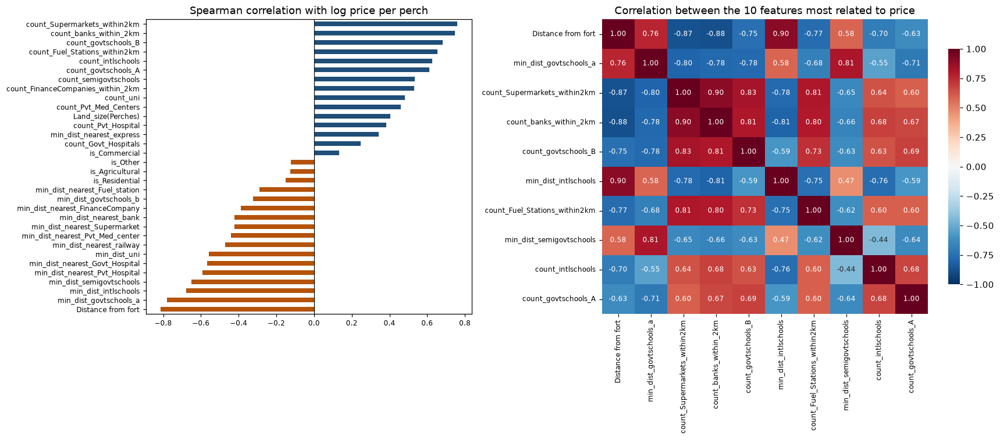

The right-hand side of Figure 3 shows that the location features are **strongly correlated with each other**.
Among the ten features most related to price, **22 of the 45 pairs have |ρ| above 0.7**; for example, distance
from Fort and the number of banks within 2 km have ρ = −0.88. These features mostly describe the same thing:
how central and built-up an area is. This multicollinearity is why Random Forest was allowed to consider only
a subset of features at each split (Section 4.3), and why feature importances must be read for location as a
whole rather than feature by feature (Sections 6.1 and 6.4). It was also the first sign of the finding in
Section 3.7, that the location features are recorded per area.

The final modelling table has **4,275 rows, 33 features and the log target**.

---

## 4. Methodology

### 4.1 Data split and validation

* **One listing was set aside** for the inference demonstration (a 9.7-perch plot in Dampe) before anything
  else. It was not used in training, tuning or testing.
* The remaining 4,274 rows were split **80/20** into training (3,419) and test (855) sets. The split was
  stratified by price thirds, so cheap and expensive land are equally represented in both sets.
* All tuning and model **selection** used **5-fold cross-validation on the training set only**. Each model
  was evaluated on the test set once, so the choice of final model is not biased towards whatever happened
  to suit the test split.

**Metrics.** The main metric is the **RMSE of the log price**. Because the target is in logs, an RMSE of 0.37
means predictions are typically within a factor of about e^0.37 ≈ 1.45 of the true price. R² on the log
scale is also reported. Converted back to rupees, the MAE, the mean absolute percentage error (MAPE) and the
median absolute percentage error are reported. The **median** percentage error is the most useful single
number for a buyer, since it isn't dominated by a few very cheap plots where a small rupee error is a large
percentage.

### 4.2 Models

| Model | Why it was included |
|---|---|
| **Ridge regression** | Baseline. If tree models can't beat a linear model clearly, their extra complexity isn't justified |
| **Random Forest** | Required. Averages many deep, de-correlated trees; robust to noise and needs little preprocessing |
| **XGBoost** | Required. Gradient boosting: trees built one after another, each correcting the errors of the previous ones |
| **LightGBM** | Another gradient boosting library that grows trees leaf-wise; a check that XGBoost's result isn't implementation-specific |
| **CatBoost** | Built for categorical features. The most informative feature, `Address`, has 160 categories, and CatBoost encodes them with ordered target statistics |
| **Stacking** | Combines the tuned RF, XGBoost and CatBoost with a Ridge meta-model; helps when the base models make different mistakes |

Deep learning was not used, following the module guideline, and with 4,000 tabular rows it would not be
expected to beat gradient boosting anyway.

### 4.3 Hyperparameter design

Every model was first trained with **library defaults**, then tuned with `RandomizedSearchCV` (5-fold CV,
minimising log RMSE). The search ranges were chosen for this dataset of about 3,400 training rows and
33 features, whose prices are noisy because they are asking prices, not sale prices.

**Random Forest** (25 candidates)

| Parameter | Search range | Selected | Reasoning |
|---|---|---|---|
| `n_estimators` | 200-800 | 271 | More trees reduce variance, but the gain flattens after a few hundred |
| `max_depth` | 10, 15, 20, 30, unlimited | 20 | Unlimited trees can memorise individual listings |
| `min_samples_leaf` | 1, 2, 3, 5, 8 | 3 | Leaves of a single listing would fit noise in the asking prices |
| `max_features` | 0.3-1.0 | 0.3 | Many features are highly correlated (Section 3.7); considering fewer at each split makes the trees more different from each other |
| `max_samples` | 70%, 85%, 100% | 100% | Bootstrap sample size |

**XGBoost** (40 candidates)

| Parameter | Search range | Selected | Reasoning |
|---|---|---|---|
| `learning_rate` | 0.01-0.2 (log scale) | 0.0127 | Small steps generalise better but need more trees |
| `n_estimators` | 300-1500 | 1066 | Paired with the small learning rate |
| `max_depth` | 3-8 | 5 | Boosted trees should be shallow; each corrects only part of the error |
| `min_child_weight` | 1-10 | 1 | Minimum data needed in a leaf |
| `subsample` / `colsample_bytree` | 0.6-1.0 / 0.5-1.0 | 0.79 / 0.78 | Random row and column sampling to reduce overfitting |
| `reg_lambda` / `gamma` | 0.1-10 / 0-0.3 | 4.04 / 0.18 | L2 penalty on leaf values, and minimum gain required to split |

**LightGBM** (30 candidates) selected `num_leaves` 15, `learning_rate` 0.0125, `n_estimators` 820,
`min_child_samples` 11, `subsample` 0.60, `colsample_bytree` 0.90 and `reg_lambda` 0.25.

**CatBoost** (12 candidates from a grid of depth 4/6/8, learning rate 0.03/0.06/0.1, `l2_leaf_reg`
1/3/5/10 and 800/1200 iterations) selected depth 8, learning rate 0.03, `l2_leaf_reg` 5 and 800 iterations.

A pattern runs through all of these choices: **every model chose strong regularisation**. Random Forest
considers only 30% of features per split and needs 3 listings per leaf. XGBoost and LightGBM chose very small
learning rates, sub-sampling and small trees (LightGBM's 15 leaves is near the bottom of its range). This is
consistent with what Section 3.7 found: within an area there is little real signal beyond size and type, so
the best models are the ones that avoid chasing noise.

---

## 5. Results

### 5.1 Model comparison

| Model | CV RMSE (log) | Test RMSE (log) | Test R² (log) | Test MAE (Rs/perch) | Test MAPE | Test median APE |
|---|---|---|---|---|---|---|
| **Stacking (RF + XGB + Cat)** | **0.4265** | **0.3677** | **0.866** | 554,620 | 23.2% | 11.8% |
| LightGBM (tuned) | 0.4274 | 0.3726 | 0.862 | 567,464 | 24.5% | 13.5% |
| XGBoost (tuned) | 0.4282 | 0.3729 | 0.862 | 561,203 | 24.2% | 12.2% |
| Random Forest (tuned) | 0.4289 | 0.3742 | 0.861 | 552,220 | 23.1% | 11.5% |
| CatBoost (tuned) | 0.4311 | 0.3677 | 0.866 | 565,099 | 24.0% | 12.3% |
| Random Forest (default) | 0.4450 | 0.4092 | 0.834 | 537,807 | 24.3% | 10.3% |
| XGBoost (default) | 0.4490 | 0.4138 | 0.830 | 594,944 | 25.6% | 11.0% |
| Ridge (baseline) | 0.4509 | 0.4063 | 0.836 | 594,270 | 28.8% | 16.5% |

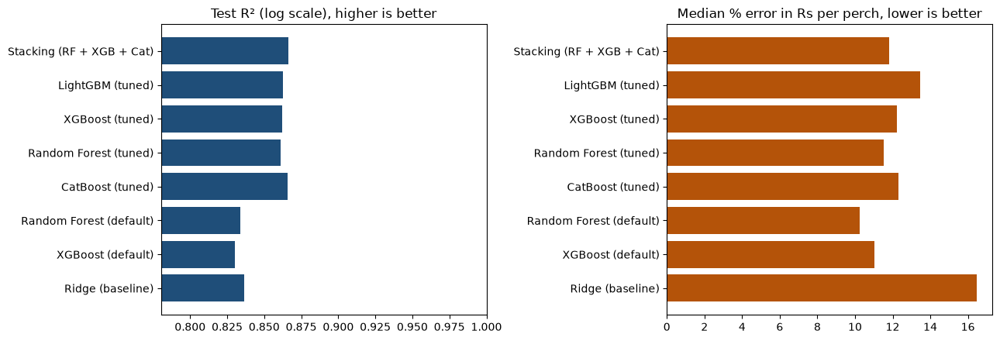

The main observations are:

1. **Tuning clearly helped.** Tuning reduced the cross-validated RMSE of Random Forest from 0.445 to 0.429
   and of XGBoost from 0.449 to 0.428. Test R² rose from about 0.83 to 0.86 for both. The defaults
   (unlimited tree depth for Random Forest, a fast learning rate for XGBoost) overfit this noisy data.
2. **The tuned tree models are very close to each other.** All five tuned models fall within 0.005 RMSE in
   cross-validation, which is smaller than the variation between folds. No single algorithm is clearly
   better here; the dataset, not the algorithm, limits the accuracy.
3. **The linear baseline is already strong** (R² 0.836). The tree models improve on it by about 3 points of
   R² and cut its median error from 16.5% to about 12%. That improvement is real and useful, but modest.
   Section 6.3 explains why: most of the price is explained by the area, which even a linear model captures
   through the target-encoded area feature.
4. **The default Random Forest has the lowest median error (10.3%)** despite having a worse RMSE. RMSE
   penalises large errors heavily, so tuning for RMSE made the models more careful about the expensive
   outliers, at a small cost on typical listings. Which one is "better" depends on whether large errors or
   typical errors matter more. For a pricing tool, avoiding large mistakes is the better priority, so the
   RMSE-based selection was kept.

### 5.2 Final model

The **stacked ensemble** had the lowest cross-validated RMSE (0.4265) and was selected as the final model.
On the test set it also shares the best R² (0.866) with CatBoost. The Ridge meta-model gave weights of
**0.47 to Random Forest, 0.30 to CatBoost and 0.22 to XGBoost**. The ensemble leans most on Random Forest,
whose averaging approach makes different errors from the two boosting models.

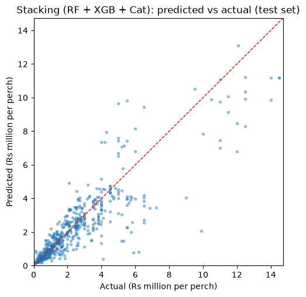

Figure 5 shows the predictions follow the actual prices well across the range. Two patterns are visible:
the spread grows with price (expected, since errors are roughly proportional), and the very highest prices
are under-predicted. Rare, very expensive plots in central Colombo are pulled towards the average of their
area.

---

## 6. Interpretation

### 6.1 Which features matter

Permutation importance was used: each feature is shuffled in the test set, and the importance is how much
the RMSE increases. Unlike the built-in importances, this works the same way for every model, including the
stacked ensemble.

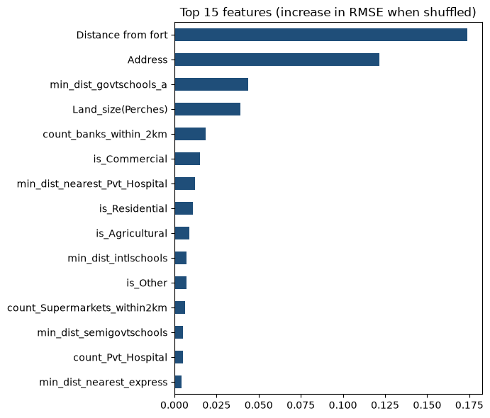

The two strongest features are **distance from Colombo Fort** and **area**. Because all location features are
constant within an area (Section 3.7), these two carry largely the same information, and the importance is
divided between them somewhat arbitrarily. The fair reading is that **location as a whole dominates**.
Among the remaining features, **land size** and the **land type** columns (commercial, residential,
agricultural) matter most, since they are the only features that vary between plots in the same area.

The direction of the main effects, measured directly from the data (median price per perch by quartile):

| Feature | Lowest quartile | Highest quartile | Direction |
|---|---|---|---|
| Distance from Fort | Rs 3.75 M (3-13 km) | Rs 0.44 M (22-43 km) | About **8.5× cheaper** furthest from the city |
| Distance to railway | Rs 2.60 M (< 1 km) | Rs 0.44 M (> 6.7 km) | Closer to rail = more expensive |
| Banks within 2 km | Rs 0.59 M (0-2 banks) | Rs 3.70 M (15+ banks) | Proxy for how commercial/urban the area is |
| Land size | Rs 0.65 M (≤ 7 perches) | Rs 2.35 M (> 16 perches) | Larger plots cost **more** per perch |

The last row is counter-intuitive, since bulk land is usually cheaper per unit. It is most likely explained
by **where** the plots are, not by their size. Small plots of 6-10 perches are typical of suburban housing
developments sold off a larger block, while large plots in the dataset are more often commercial land in
built-up areas. This is a reminder that these figures show associations, not causes.

### 6.2 Price-band classification

For the classification extension, the training prices were split into thirds:
**Low** (below Rs 672,486 per perch), **Medium** (up to Rs 1,800,000) and **High** (above). The band edges
were calculated from the training data only.

| Model | Accuracy | Macro F1 |
|---|---|---|
| **Random Forest classifier (tuned)** | **0.905** | **0.905** |
| XGBoost classifier (tuned) | 0.897 | 0.896 |
| Final regression model, prediction converted to a band | 0.892 | 0.892 |

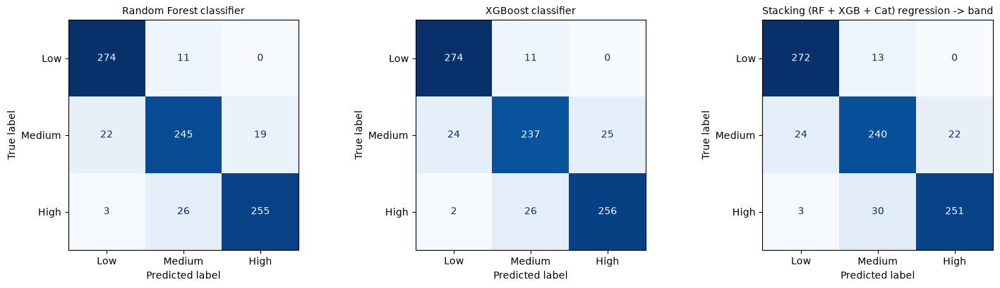

All three approaches reach about **90% accuracy**, and almost every mistake is between **neighbouring**
bands. A Low plot is almost never classified as High or the other way round (Figure 7). **Medium** is the
hardest class (F1 0.86, against 0.94 for Low and 0.91 for High), as expected: plots near either edge of the
Medium band can fall on either side through small price differences. Training a dedicated classifier gave
only slightly better results than converting the regression output to a band. This shows the two framings
capture the same underlying information.

### 6.3 Seen areas vs. unseen areas

Because the location features are fixed per area (Section 3.7), the price variation can be split into two
parts. **81% of the variance in log price is between areas** and only **19% is within areas**. Most of what
the models learn is therefore "what does land cost in this area", and the remaining 19% has to be explained
by land size, land type and noise.

The random split used in Section 5 tests **seen areas**: almost every area in the test set also appears in the
training set. That is the right test for the application, which only offers areas from the dataset. It
doesn't show whether the models have learnt anything **general** about location. To check that, the models
were also evaluated with **grouped cross-validation** (`GroupKFold`, grouped by area). Each fold's test areas
are completely absent from its training data, so the model can't use the area name and has to rely on the 27
location features (`03_unseen_areas.ipynb`).

| Model | CV RMSE, seen areas | CV R², seen areas | CV RMSE, unseen areas | CV R², unseen areas |
|---|---|---|---|---|
| Ridge (baseline) | 0.451 | 0.808 | 0.672 | 0.541 |
| Random Forest (tuned) | 0.429 | 0.827 | 0.557 | 0.688 |
| XGBoost (tuned) | 0.428 | 0.827 | 0.576 | 0.665 |
| **CatBoost (tuned)** | 0.431 | 0.825 | **0.542** | **0.703** |

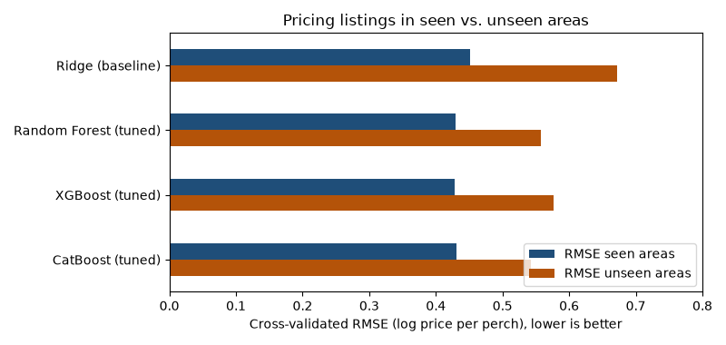

(These are cross-validation figures on the training set, which is why the seen-area R² of about 0.83 is a
little lower than the 0.86 measured on the test set in Section 5.)

Three conclusions follow:

1. **Unseen areas are much harder.** The error rises from about 0.43 to 0.54-0.58 for the tree models. In
   practical terms, a typical prediction moves from within a factor of about 1.5 of the true price to within a
   factor of about 1.7. The models are noticeably less reliable for an area outside the dataset, which is why
   the application only offers known areas.
2. **This is where the tree models really earn their place.** With seen areas, the tree models beat Ridge by
   only about 0.02 in RMSE. With unseen areas the gap grows to over 0.1: R² 0.69-0.70 against 0.54. Once the
   area name isn't available, price has to be inferred from the distances and counts, and those
   relationships are non-linear (the effect of distance to Fort flattens out beyond about 20 km, for example).
   Trees capture that; a linear model can't.
3. **The location features do carry real, general information.** An R² of 0.70 for areas the model has never
   seen means that distance to the city, transport and the density of banks, schools and hospitals explain
   most of the difference in price **between** areas. Within an area, as noted, they can't help, because they
   don't vary.

CatBoost generalises best to new areas. Its ordered target statistics treat an unknown area cleanly as
"no information", while the stacked ensemble's target encoder falls back to the overall average. For a future
version of the application that allowed **new** areas, CatBoost on its own would be the better choice. For the
current application, restricted to known areas, the stacked ensemble remains the best model.

### 6.4 Explainability with SHAP and LIME

Permutation importance (Section 6.1) shows *which* features matter overall. It doesn't show in which
**direction** they push the price, or why the model priced one particular plot as it did. Two explainability
methods were applied to the **final stacked model** for this (`04_explainability.ipynb`):

* **SHAP** splits every prediction into a contribution from each feature, so that the baseline plus the sum
  of the contributions equals the prediction. Because a stacked ensemble can't be opened up by tree-specific
  methods, the model-agnostic `PermutationExplainer` was used, with 50 training listings as the background,
  to explain 120 test listings.
* **LIME** explains a single prediction. It creates 5,000 perturbed copies of the listing, asks the model to
  price each one, and fits a simple weighted linear model to the answers.

Both methods work on numbers, so each area name was given an integer code, and a small wrapper converts the
codes back to names before calling the model. A check confirmed that the wrapper gives exactly the same
predictions as the model. All explanations are on the **log** scale, where a contribution of −0.10 means
roughly 10% lower in price.

**Global explanation (SHAP).**

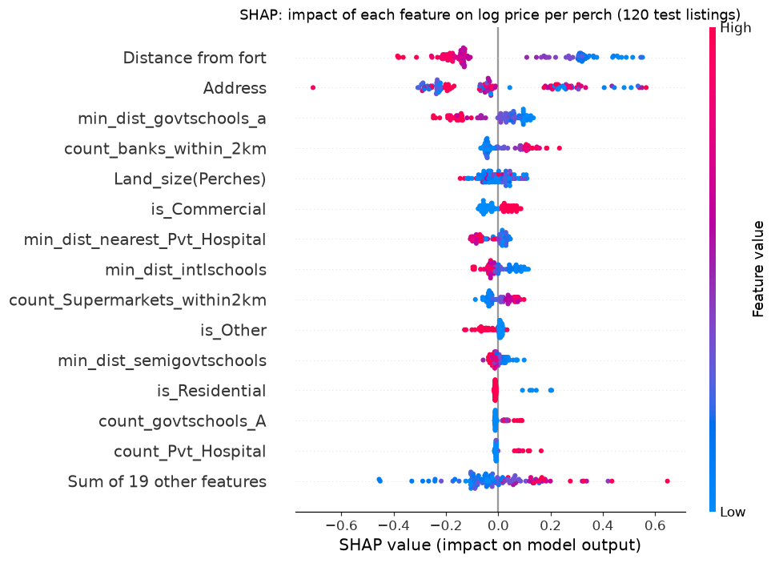

Figure 9 confirms the direction of the main effects found in Section 6.1, now for the model itself rather
than the raw data:

* **Distance from Fort:** a long distance (red) pushes the price down by up to about 0.4 (around 33% lower).
  Short distances (blue) push it up by as much as 0.5.
* **Banks within 2 km** and **supermarkets within 2 km:** more of them (red) raise the price, a sign of a
  built-up, commercial area.
* **Distance to grade-A government schools** and **private hospitals:** being far from them lowers the
  price.
* **Land type:** commercial land (`is_Commercial` = 1) is priced higher, and land listed as "Other" lower.
* **Land size** has small effects in both directions, which matches its low importance.

**Grouped view.** Section 3.7 showed that the location features are constant within an area, so SHAP splits
the credit between them somewhat arbitrarily. Adding the contributions together gives a fairer summary:

| Feature group | Share of total SHAP impact |
|---|---|
| **Location** (area + 27 distance and count features) | **87.1%** |
| Land type (4 columns) | 8.6% |
| Land size | 4.3% |

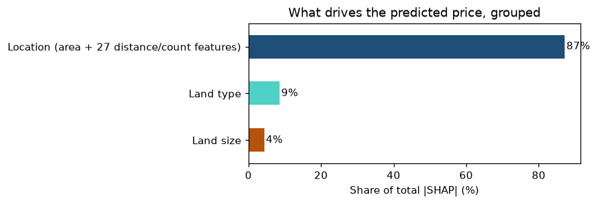

This matches the finding in Section 6.3 that 81% of price variation lies between areas, reached in a
completely different way. **Where the land is explains almost all of the model's decisions.**

**Local explanation of the held-out listing (SHAP).** The Dampe listing kept aside for inference (Section 7.1)
had an actual price of Rs 300,000 per perch and a predicted price of Rs 332,620.

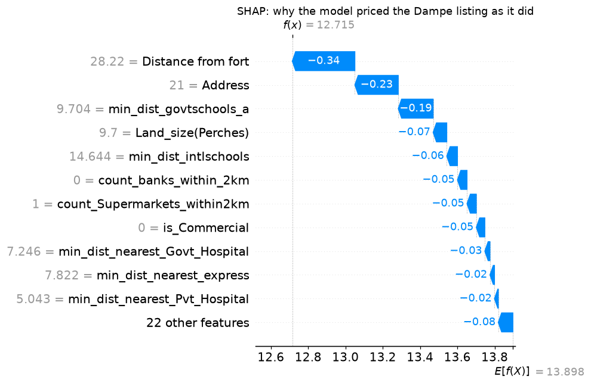

The model starts from the average prediction (13.898 on the log scale, about Rs 1.09 million per perch). Every
major feature then pulls the price **down**. The plot is 28 km from Fort (−0.34), Dampe is a low-priced area
(−0.23), the nearest grade-A school is almost 10 km away (−0.19), and there are no banks and only one
supermarket within 2 km. The contributions add up to −1.183, which gives 12.715 on the log scale: exactly the
model's prediction of Rs 332,620. In plain terms, the model sees an outer-suburban, non-commercial plot far
from city amenities and prices it at about a third of the average.

**Local explanation of the same listing (LIME).**

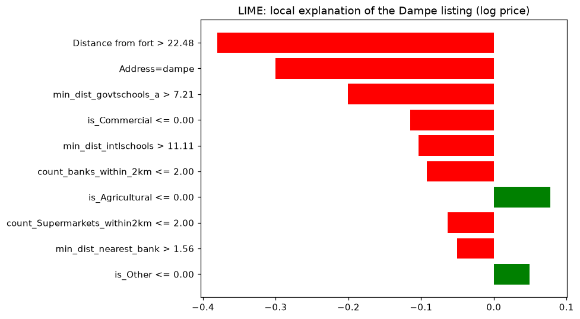

**Comparison of the two methods** for the Dampe listing:

| Feature | SHAP contribution | LIME weight | Same direction? |
|---|---|---|---|
| Distance from Fort | −0.336 | −0.380 | Yes |
| Address (Dampe) | −0.233 | −0.300 | Yes |
| Distance to grade-A govt. school | −0.187 | −0.201 | Yes |
| Land size | −0.073 | – | Not in LIME's top 10 |
| Distance to international school | −0.057 | −0.104 | Yes |
| Banks within 2 km | −0.051 | −0.092 | Yes |
| Supermarkets within 2 km | −0.050 | −0.063 | Yes |
| Commercial land | −0.046 | −0.115 | Yes |

The two methods **agree on the top three drivers, in the same order and with similar sizes**, and on the
direction of every feature they both list. This agreement makes the explanation more trustworthy, since the
methods work in very different ways.

**Limits of the explanations.**

* LIME's local linear model has an R² of only **0.29**, so it captures the model's behaviour around this
  listing only roughly. It is best read as a check on direction, with SHAP as the main explanation.
* Both methods change one feature at a time. Here the location features always move together, so some
  perturbed listings combine one area's name with another area's distances, a combination that never
  occurs in the data. This is why the grouped SHAP view is the most reliable reading, and why individual
  location features should be read as a group.

---

## 7. Inference and Application

### 7.1 Inference on a held-out listing

The listing set aside at the very start (Section 4.1) was used to demonstrate inference. The model was
loaded back from the pickle file, exactly as the application does:

| | |
|---|---|
| Listing | Dampe, 9.7 perches |
| Actual asking price | **Rs 300,000** per perch |
| Predicted price | **Rs 332,620** per perch (**+10.9%**) |
| Predicted total price | Rs 3,226,419 |
| Predicted band | **Low** (correct) |

The error of about 11% is in line with the test set's median error of 11.8%.

### 7.2 Front-end application

A small web application (`app.py`, built with Streamlit) puts the model in front of a user. The user:

1. selects the **area** from the 160 areas in the dataset,
2. enters the **land size** in perches, and
3. selects one or more **land types**.

The application then shows the **predicted price per perch**, the **estimated total price** and the **price
band**. The model, the feature list, the band edges and each area's location values are all loaded from
`land_price_model.pkl`. The location features are filled in automatically from the selected area and shown
for information only. Section 3.7 showed they are fixed per area, so letting the user edit them would create
combinations the model never saw.

Two example predictions for a 10-perch residential plot:

| Area | Predicted price per perch | Band |
|---|---|---|
| Kollupitiya (central Colombo) | about Rs 13.1 million | High |
| Kaduwela (suburban) | about Rs 460,000 | Low |

To run the application locally: `pip install -r requirements.txt`, then `streamlit run app.py` from the
`Assignment_2` folder. It is also deployed online (Section 7.3).

### 7.3 Repository, deployment and MLOps

The project is published in a private GitHub repository (github.com/amalr-12/colombo-land-price-ml) and the
application is deployed on Streamlit Community Cloud:

**Live application:** https://colombo-land-price-ml-5jekcfuzve5ezgfgjjpqoh.streamlit.app

The deployed app gives exactly the same predictions as the local model (for example, a 10-perch residential plot
in Udahamulla: Rs 1,999,440 per perch, High band, both locally and online).

To make the model maintainable rather than a one-off notebook result, a small MLOps pipeline was added:

```
raw Excel -> src/prepare.py -> clean data -> src/train.py -> candidate model + metrics.json
                                                                  |
                                   src/promote.py (quality gate) <-+
                          R2 >= 0.85 and not worse than deployed by > 0.005?
                            yes -> replace land_price_model.pkl (old one backed up)
                            no  -> reject; deployed model unchanged
```

* **Reproducible retraining.** `run_pipeline.py` rebuilds the model from the raw Excel file with the tuned
  hyperparameters stored in `config/params.json`, using the same seed, held-out listing and split as the
  notebooks. It took 4.4 minutes and reproduced the notebook: identical cleaned data, and test R² 0.8659
  against 0.8661.
* **Quality gate.** A retrained model replaces the deployed one only if its test R² is at least 0.85 and not
  more than 0.005 below the current model. In testing, the gate accepted the real retrained model and rejected
  candidates with R² 0.80 and 0.858.
* **Automated tests.** 14 tests check the data rules (row count, no duplicates, no leaky columns), the model's
  behaviour (the held-out listing reproduces the notebook's prediction; central Colombo is priced above the
  suburbs; all predictions are finite) and that the app starts and returns a prediction.
* **Continuous integration.** A GitHub Actions workflow runs the tests on Linux on every push. The first run
  passed, confirming that the model trained on Windows loads and predicts correctly with the pinned library
  versions used by the cloud deployment.
* **Retraining on demand.** A second workflow, started manually from GitHub's Actions tab, runs the full
  pipeline in the cloud and uploads the candidate model and its metrics for review.
* **Continuous deployment.** Streamlit Community Cloud redeploys the app automatically whenever the `main`
  branch changes.
* **Pinned dependencies.** `requirements.txt` fixes the exact library versions, because a pickled model must be
  loaded with the versions it was trained with.

---

## 8. Limitations and Future Work

* **Asking prices, not sale prices.** Advertisements show what sellers hope to get. Actual transaction prices
  are usually lower and are not public in Sri Lanka.
* **The data is from 2021.** Since then, the 2022 economic crisis and high inflation have changed land prices
  considerably, so the absolute rupee values are out of date. The **relative** patterns (location, size and
  type effects) are more likely to still hold. The model should be retrained on recent listings before
  practical use.
* **Location is recorded per area, not per plot** (Section 3.7). This is the biggest limitation. Two plots in
  the same area, one on a main road and one down a narrow lane, look identical to the model. Geocoding each
  listing would let the 27 location features describe the actual plot.
* **Missing plot features** such as road frontage, road width, shape, slope and flood risk are known to
  affect Sri Lankan land prices strongly but are not in the dataset.
* **Repeated developer listings.** Many plots from the same block, advertised at the same price, can appear
  in both the training and test sets. This makes the seen-area scores somewhat optimistic for genuinely new
  developments.

---

## 9. Conclusion

A model was built to estimate the asking price per perch of land in the Colombo district from 4,275 cleaned
listings. Preprocessing corrected a price-scale error in the data, removed duplicates, and handled the
heavily skewed target with a log transform, so that only 21 true outliers had to be removed instead of 297
genuine high-value listings. Random Forest and XGBoost were tuned instead of used with defaults, which
improved R² from about 0.83 to 0.86, and LightGBM, CatBoost and a stacked ensemble were added. The stacked
ensemble was selected as the final model on cross-validation, reaching an R² of 0.866 on the log scale and a
median error of about 12%. A Random Forest classifier assigned Low, Medium and High price bands with 90.5%
accuracy.

The most important finding came from the data rather than the models: the location features are recorded per
area, not per plot. As a result, **location (area) explains most of the price**, all well-tuned tree models
perform almost identically, and accuracy is limited by the data rather than by the choice of algorithm.
SHAP confirmed this from inside the model: location accounts for 87% of its decisions. SHAP and LIME
explanations of the held-out listing agreed on its main drivers (distance from the city, the area itself, and
distance to good schools). Better
data, meaning per-plot coordinates, recent prices and plot features such as road access, would improve the
model more than any further tuning.

---

## Use of AI Tools

[**To review and adjust before submission.**] In line with the module guideline, AI assistance (Claude) was
used for coding support and for generating the front-end application. The modelling decisions, results and
interpretation were reviewed and understood by the author, and all numbers in this report come from the
accompanying notebooks.

---

## References

1. Breiman, L. (2001). Random Forests. *Machine Learning*, 45(1), 5-32.
2. Chen, T. and Guestrin, C. (2016). XGBoost: A Scalable Tree Boosting System. *Proceedings of the 22nd ACM
   SIGKDD International Conference on Knowledge Discovery and Data Mining*, 785-794.
3. Ke, G. et al. (2017). LightGBM: A Highly Efficient Gradient Boosting Decision Tree. *Advances in Neural
   Information Processing Systems 30*.
4. Prokhorenkova, L. et al. (2018). CatBoost: unbiased boosting with categorical features. *Advances in Neural
   Information Processing Systems 31*.
5. Pedregosa, F. et al. (2011). Scikit-learn: Machine Learning in Python. *Journal of Machine Learning
   Research*, 12, 2825-2830.
6. ruchiraayeshmantha (n.d.). *Land prices of Colombo district* [Dataset]. Kaggle.
   https://www.kaggle.com/datasets/ruchiraayeshmantha/land-prices-of-colombo-district (accessed 8 October 2026).
7. Lundberg, S. M. and Lee, S.-I. (2017). A Unified Approach to Interpreting Model Predictions. *Advances in
   Neural Information Processing Systems 30*.
8. Ribeiro, M. T., Singh, S. and Guestrin, C. (2016). "Why Should I Trust You?": Explaining the Predictions of
   Any Classifier. *Proceedings of the 22nd ACM SIGKDD International Conference on Knowledge Discovery and Data
   Mining*, 1135-1144.
9. IT5514 Applied Machine Learning lecture notes and lab sheets: Decision Trees and Random Forest, XGBoost,
   and the feature engineering lab (IQR outlier method).
